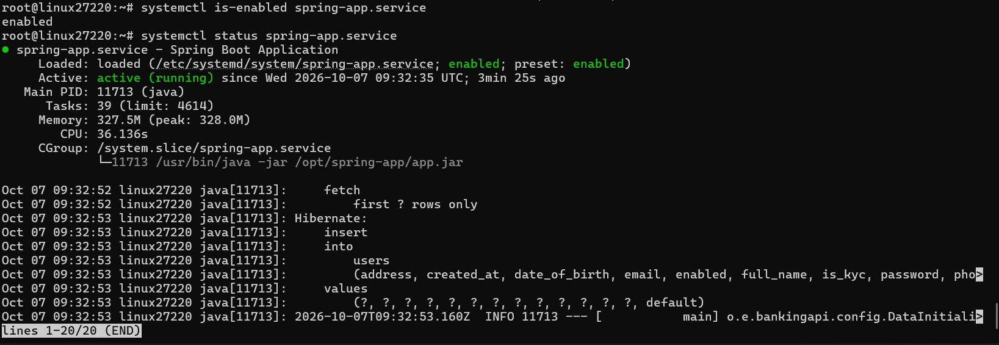

# Bài 3: Thiết lập Cơ sở dữ liệu và Tự cấu hình dịch vụ Systemd cho Spring Boot

## 1. Mục tiêu

* Thiết lập môi trường chạy ứng dụng Spring Boot trên Ubuntu Server.
* Tạo user riêng để chạy ứng dụng.
* Đưa file JAR lên VPS.
* Cấu hình ứng dụng chạy tự động bằng Systemd.
* Kiểm tra ứng dụng hoạt động trên port 8082.

## 2. User chạy ứng dụng

Tạo user hệ thống:

```bash
useradd --system --no-create-home --shell /usr/sbin/nologin spring-runner
```

Kiểm tra:

```bash
id spring-runner
```

User được sử dụng để chạy Spring Boot là:

```text
spring-runner
```

## 3. Deploy file JAR

Thư mục ứng dụng:

```text
/opt/spring-app
```

File JAR:

```text
/opt/spring-app/app.jar
```

Kiểm tra:

```bash
ls -lh /opt/spring-app/app.jar
```

File thuộc quyền sở hữu của:

```text
spring-runner:spring-runner
```

## 4. Cấu hình Systemd

File service:

```text
/etc/systemd/system/spring-app.service
```

Service sử dụng:

```ini
User=spring-runner
Group=spring-runner
WorkingDirectory=/opt/spring-app
ExecStart=/usr/bin/java -jar /opt/spring-app/app.jar
Restart=on-failure
RestartSec=10
```

## 5. Khởi động Systemd

```bash
systemctl daemon-reload
systemctl enable spring-app.service
systemctl start spring-app.service
```

Kiểm tra:

```bash
systemctl status spring-app.service
```

Kết quả:

```text
Active: active (running)
```

Service được bật tự động khi hệ thống khởi động:

```bash
systemctl is-enabled spring-app.service
```

Kết quả:

```text
enabled
```

## 6. Kiểm tra port

Ứng dụng Spring Boot chạy trên port:

```text
8082
```

Kiểm tra:

```bash
ss -tlnp | grep 8082
```

Kết quả:

```text
LISTEN 0 100 *:8082 *:* users:(("java",pid=11713,fd=9))
```

## 7. Kết quả

Ứng dụng Spring Boot đã được triển khai thành công trên VPS.

* User chạy ứng dụng: `spring-runner`
* File JAR: `/opt/spring-app/app.jar`
* Systemd service: `spring-app.service`
* Trạng thái: `active (running)`
* Tự khởi động cùng hệ thống: `enabled`
* Port ứng dụng: `8082`
* Ứng dụng đang LISTEN trên port `8082`.

### Hình ảnh minh chứng




