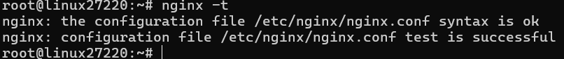

# Bài 4: Cấu hình Reverse Proxy Nginx cho ứng dụng Spring Boot

## 1. Mục tiêu

* Cài đặt và cấu hình Nginx trên Ubuntu Server.
* Cấu hình Nginx Server Block làm Reverse Proxy.
* Phục vụ trang web tĩnh trực tiếp từ Nginx.
* Chuyển tiếp các request bắt đầu bằng `/api/` đến ứng dụng Spring Boot.
* Kiểm tra cấu hình và hoạt động của hệ thống.

---

## 2. Cài đặt Nginx

Cài đặt Nginx:

```bash
apt update
apt install -y nginx
```

Kiểm tra phiên bản:

```bash
nginx -v
```

Kiểm tra dịch vụ:

```bash
systemctl status nginx
```

Nginx hoạt động bình thường.

---

## 3. Tạo trang web tĩnh

Tạo thư mục:

```bash
mkdir -p /var/www/html
```

Tạo file:

```bash
nano /var/www/html/index.html
```

Nội dung trang:

```html
<!DOCTYPE html>
<html lang="vi">
<head>
    <meta charset="UTF-8">
    <title>Spring Boot VPS</title>
</head>
<body>
    <h1>Thông tin học viên</h1>
    <p><strong>Họ tên:</strong> Khánh</p>
    <p><strong>Mã lớp:</strong> Linux27220</p>
</body>
</html>
```

---

## 4. Cấu hình Nginx Reverse Proxy

Tạo file:

```bash
nano /etc/nginx/sites-available/spring-proxy.conf
```

Nội dung cấu hình:

```nginx
server {
    listen 80;
    listen [::]:80;

    server_name _;

    root /var/www/html;
    index index.html;

    location / {
        try_files $uri $uri/ /index.html;
    }

    location /api/ {
        proxy_pass http://127.0.0.1:8082/;

        proxy_set_header Host $host;
        proxy_set_header X-Real-IP $remote_addr;
        proxy_set_header X-Forwarded-For $proxy_add_x_forwarded_for;
        proxy_set_header X-Forwarded-Proto $scheme;
    }
}
```

### Ý nghĩa cấu hình

* `/` → Nginx phục vụ file tĩnh từ `/var/www/html/`.
* `/api/` → Nginx chuyển tiếp request đến Spring Boot tại `127.0.0.1:8082`.
* `Host` và thông tin IP client được chuyển tiếp đến Backend.
* Server lắng nghe trên port `80`.

---

## 5. Kích hoạt Server Block

Tạo symbolic link:

```bash
ln -s /etc/nginx/sites-available/spring-proxy.conf /etc/nginx/sites-enabled/spring-proxy.conf
```

Kiểm tra:

```bash
ls -l /etc/nginx/sites-enabled/spring-proxy.conf
```

Kết quả:

```text
spring-proxy.conf -> /etc/nginx/sites-available/spring-proxy.conf
```

---

## 6. Kiểm tra cấu hình Nginx

Chạy:

```bash
nginx -t
```

Kết quả:

```text
nginx: the configuration file /etc/nginx/nginx.conf syntax is ok
nginx: configuration file /etc/nginx/nginx.conf test is successful
```

Sau khi kiểm tra thành công, reload Nginx:

```bash
systemctl reload nginx
```

---

## 7. Kiểm tra trang web tĩnh

Chạy:

```bash
curl -I http://localhost/
```

Kết quả:

```text
HTTP/1.1 200 OK
Server: nginx/1.24.0 (Ubuntu)
Content-Type: text/html
```

Như vậy Nginx đã phục vụ thành công trang web tĩnh tại `/`.

---

## 8. Kiểm tra Reverse Proxy

Ứng dụng Spring Boot đang chạy tại:

```text
127.0.0.1:8082
```

Kiểm tra trực tiếp Backend:

```bash
curl -i http://127.0.0.1:8082/
```

Kết quả:

```text
HTTP/1.1 403
```

Backend hoạt động và Spring Security đang bảo vệ endpoint.

Kiểm tra thông qua Nginx:

```bash
curl -i http://localhost/api/
```

Kết quả:

```text
HTTP/1.1 403
Server: nginx/1.24.0 (Ubuntu)
X-Content-Type-Options: nosniff
Cache-Control: no-cache, no-store, max-age=0, must-revalidate
X-Frame-Options: DENY
```

Request `/api/` đã được Nginx chuyển tiếp thành công đến Spring Boot. HTTP 403 là phản hồi từ Backend do Spring Security yêu cầu xác thực/quyền truy cập, không phải lỗi `502 Bad Gateway`.

---

## 9. Kiểm tra `/api/health`

Thực hiện:

```bash
curl -i http://localhost/api/health
```

Kết quả:

```text
HTTP/1.1 404 Not Found
Server: nginx/1.24.0 (Ubuntu)
```

Endpoint `/health` không được triển khai trong ứng dụng hiện tại nên trả về HTTP 404.

Việc kiểm tra `/api/` cho thấy request đã được chuyển tiếp đến Backend và nhận response từ Spring Security.

---

## 10. Kết quả

Hệ thống đã cấu hình thành công:

| Thành phần            | Kết quả      |
| --------------------- | ------------ |
| Nginx                 | Hoạt động    |
| Port Nginx            | 80           |
| Trang tĩnh `/`        | HTTP 200     |
| Spring Boot           | Port 8082    |
| Reverse Proxy `/api/` | Hoạt động    |
| `nginx -t`            | Syntax OK    |
| Server Block          | Đã kích hoạt |
| `502 Bad Gateway`     | Không xảy ra |

### Hình ảnh minh chứng




